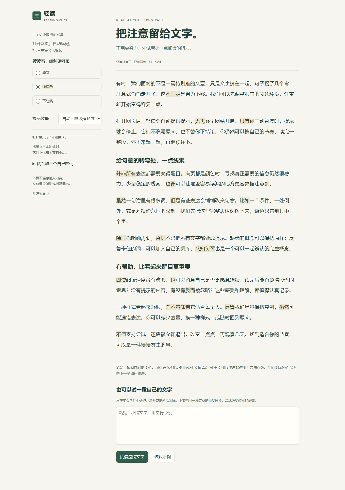

# 轻读 · Reading Cues

**打开网页，自动标记。把注意留给阅读。**

本地运行的桌面浏览器扩展。安装并完成浏览器的网站访问授权后，普通 HTTP / HTTPS 网页自动获得阅读提示，**不用逐站启用，不用先配置个人词库**。页面没有额外按钮、浮窗、提示音或操作教程。

**[下载 v0.2.0](https://github.com/Yueyue673/reading-cues/releases/latest) · [研究与设计依据](docs/RESEARCH.md) · [验证报告](docs/VALIDATION.md) · [反馈与贡献](CONTRIBUTING.md)**



## 这次改了什么

- **全局自动**：不再使用 v0.1 的逐站白名单。新网页、动态新增的正文、普通 HTTP / HTTPS 嵌入页自动处理；已有标签页也会尝试自动注入。
- **18 → 374 条原创规则**：341 条字面词条（568 种明确列举的词形）、20 条配对规则（32 种配对形式）、13 条上下文 / 数值模式。
- **9 类覆盖**：否定与范围、条件与例外、转折、因果、递进、顺序与时间、解释与举例、完整数值、完整概念，默认全部启用。
- **数量自动分配**：长段落自动获得更多提示，不再固定最多两组；仍限制提示字数占比，并尽量把线索分布到段落不同位置。
- **完整表达**：例如分别保留“降低了20元”和“降低到20元”；“注意力机制”优先于其中的“注意力”。相同概念每个文本块只提示一次。
- **安静运行**：不改写原文，不拆分网页文字节点，不改变字号、字色或换行。动态追加内容时保留有效提示，减少闪动。

需要时才打开插件：可以暂停当前网站、暂停全部、切换浅底色 / 下划线，或管理个人词库。设置保存在本机。没有大模型 API、账户、遥测、远程词库或运行时第三方依赖。

## 安装，不需要编程

1. 到 [Releases](https://github.com/Yueyue673/reading-cues/releases/latest) 下载 `reading-cues-0.2.0.zip`，解压到固定目录。
2. Chrome 地址栏打开 `chrome://extensions`；Edge 打开 `edge://extensions`。
3. 开启**开发者模式** → **加载已解压的扩展程序** → 选择包含 `manifest.json` 的目录。
4. 完成浏览器的网站访问授权。**打开普通网页即可自动工作**；已打开的页面如果没有更新，刷新一次。

无需到每个网站再点击“开启”。扩展不会绕过浏览器保护页或你在浏览器里手动设置的访问限制。

解压目录中的 `demo.html` 可直接双击离线试读，不保存粘贴的文字。目前尚未上架扩展商店；手机、Firefox 和 Safari 未适配。

### 从 v0.1.0 升级

可以先在旧版本设置页导出个人词库备份，再把新包覆盖到原安装目录，在扩展管理页点击重新加载。**新版从逐站访问改成全局访问，浏览器可能要求确认新增权限或重新启用扩展。** 这是浏览器控制的升级步骤，确认后不再逐站授权。

使用同一安装目录重载时，个人词库、忽略词与样式会保留；旧白名单改为全局自动，旧默认两组限制迁移为自动。显式设置的全局暂停会保留。重新加载后刷新文章页。

## 词库与控制

默认词库直接工作。选中 2–40 字的完整词语，右键选择**轻读：以后提示…**，可补充个人词库。设置页支持添加、移除、忽略和 JSON 备份；导入只合并个人词语，不导入模式、网站或权限。

全局模式只保存主动暂停的网站，不记录浏览历史。暂停顶层网站时，它里面的普通嵌入页也暂停；其他网页继续自动工作。网站暂停按协议和域名保存，不自动包含子域名；浏览器匹配不能区分端口。浏览器自身的网站访问限制优先于插件设置。

“无感”指不要求反复操作、不加页面控件、保留原文；不代表绕过浏览器的无痕窗口权限。浏览器隐私模式是否允许扩展运行，由浏览器设置决定。

## 已知边界

- 主要针对中文正文；有限词形、配对和数值规则仍会误标或漏标，不能判断文章重点、语义真伪或全部否定范围。
- 普通 HTTP / HTTPS iframe 已加入自动处理；Shadow DOM、PDF、图片文字、浏览器内置页和扩展商店保护页不在当前支持范围。
- 编辑区、代码、导航、链接、标题、作者已有的语义强调与动态通知保持原样，不跨越这些边界配对。
- 每连续文本块最多处理 8,000 个 UTF-16 单元；每文档最多约 300,000 单元、60,000 个遍历节点或 2,000 组提示。超限会在插件弹窗说明；不会在网页弹通知。
- 自动数量是工程起点，不是最优医学参数。字符预算默认 22%，短文本保留完整短语 / 日期的最小预算为 12 单元。手动上限也可调整。
- 数值模式只分组表达形式，不计算含义、验证日历合法性或提取财务结论。背景不确定或可能降低对比度时，浅底色会回退为下划线。

这仍是一项可个性化的阅读辅助实验，对中文 ADHD / 阅读障碍使用者的效果尚未验证。技术覆盖扩大不等于阅读效果已得到证明。

## 开发

需要 Node.js 22+。

```sh
npm ci
npm test
npm run build
npx playwright install --with-deps chromium
npm run test:browser
npm run package
npm run preview
```

仅构建时可离线执行 `node scripts/build.mjs`，无需安装开发依赖。加载目录为 `dist/extension/`；安装包输出在 `dist/`。

```text
src/core.js          纯函数匹配、自动密度、输入校验、全局站点判断
src/lexicon.json     374 条原创规则、稳定 ID、原创正反例
src/renderer.js      Range 高亮、动态页面、完整配对、资源上限
src/background.js    设置写入、旧版迁移、安装时处理已有网页
src/content.js       每个网页 / 嵌入页的自动启动与暂停
src/manifest.json    全局静态内容脚本与访问范围
src/popup.*          自动运行状态与可选暂停
src/options.*        个人词库、偏好、暂停站点与备份
src/demo.*           可离线运行的试读页
tests/              词条反例、独立语段、迁移和真实浏览器测试
```

[TRYOUT.md](docs/TRYOUT.md) 用来观察实际阅读负担和理解；[ROADMAP.md](docs/ROADMAP.md) 记录后续方向。自动测试与使用者效果分别记录。

## English

Reading Cues is a local Chinese reading-assistance experiment for desktop Chromium. Version 0.2 runs automatically on ordinary HTTP(S) pages after installation and browser approval, without per-site activation or page overlays. It includes 374 original literal, paired and numeric/context rules, adaptive cue density, automatic HTTP(S) iframe support, personal phrases and optional site/global pause. No LLM, telemetry or runtime dependencies. Effectiveness for Chinese readers with ADHD or dyslexia has not been established.

## 许可

[MIT](LICENSE)，适用于原创代码、规则、例句和文档。没有捆绑 Chinese-DiMLex 或其他第三方词库。开发依赖保留各自许可。详见 [隐私与权限说明](PRIVACY.md)。
