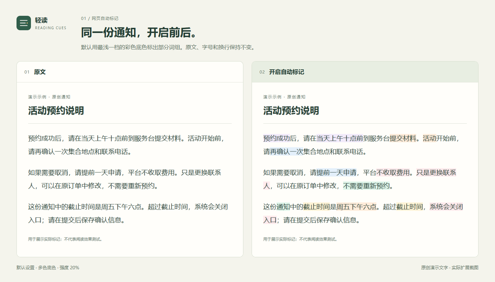
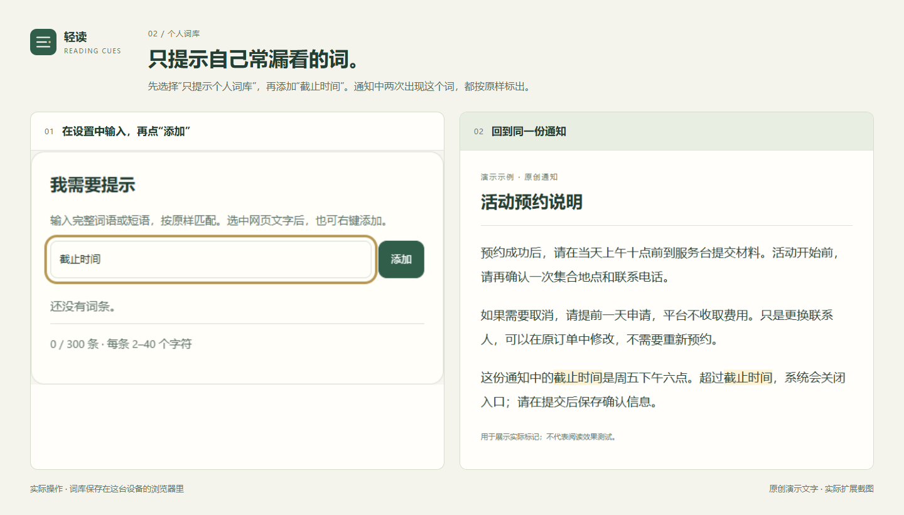
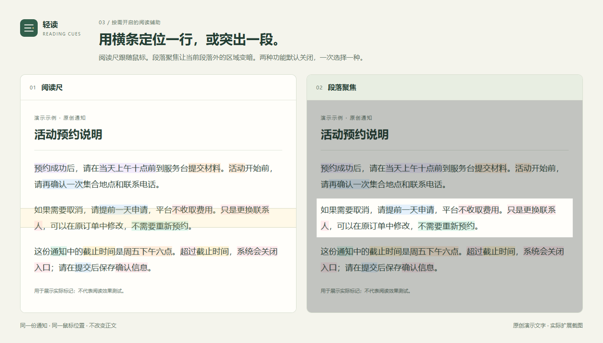
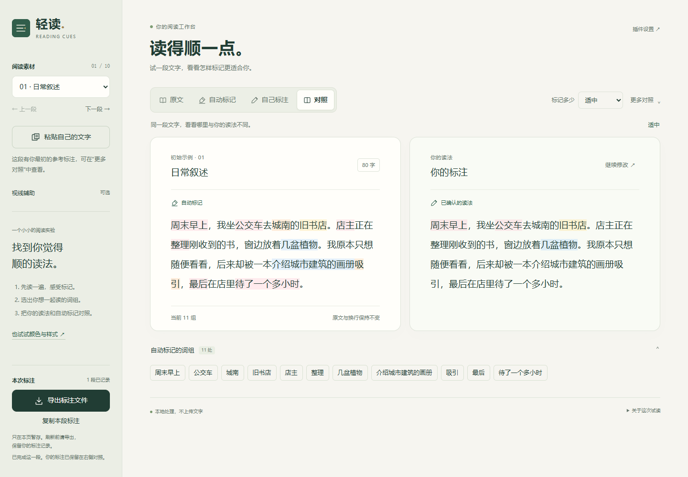

<div align="center">
  
  <h1>轻读 · Reading Cues</h1>
  <p>给中文网页里的词组加上浅色标记。</p>
  <p><a href="https://github.com/Yueyue673/reading-cues/releases/latest">下载安装包</a> · <a href="#安装和更新">安装方法</a> · <a href="README.en.md">English</a></p>
  <p><a href="https://github.com/Yueyue673/reading-cues/actions/workflows/check.yml"></a> <a href="LICENSE"></a></p>
</div>

轻读是一个免费的中文网页阅读插件。它会用浅颜色标出一些词语，帮你看清哪些字可以连在一起读。你也可以打开一条跟随鼠标的横条来定位当前行，或把周围内容变暗，集中看一段。颜色、标记数量和想提示的词都能自己调整。网页文字只在自己的电脑上处理，不会上传。

目前支持桌面 **Chrome / Edge**，需要手动安装。安装并允许访问网站后，普通网页会自动标记，无需每次开启。

## 打开网页，看看标记前后

一份通知里，时间、地点和操作要求常常挤在一起。轻读会给其中一部分词组加浅底色。下面是同一份原创通知的实际截图，文字、字号和换行都没有改变。



默认使用最浅一档的彩色底色，强度为 20%。同一个词组保持同色，滚动时不会换色；颜色不表示重要程度。

觉得太浅，可以在插件的“颜色与强度”中调深。觉得太花，可以换成单色或下划线；标记太多，就把“标记多少”改为“少一些”。也可以选择加重文字。

## 只提示你常漏看的词

例如，你只想在通知里提示“截止时间”：

1. 打开“个人词库与设置”，把“标记哪些词”改为“只提示个人词库”。
2. 在“我需要提示”里输入 `截止时间`，点“添加”。
3. 回到网页，这个词出现的地方就会有提示。



如果仍想保留自动标记，也可以在默认模式中添加个人词语。选中网页文字后，右键也能加入词库。不想再提示的词，可以加入“这些表达不再提示”。

## 用横条定位一行，或突出当前段落

如果你需要一个位置提示，可以在插件的“更多阅读辅助”中选一种：

- **阅读尺**：一条浅色横条跟随鼠标，方便定位正在看的行。
- **段落聚焦**：鼠标所在段落保持原样，周围区域变暗。



两种功能默认关闭，一次选择一种；选“关闭”即可恢复。它们不记录鼠标移动轨迹。

<details>
<summary>自动标记不合适？自己标一段，再比较</summary>

打开包内的 `compare.html`，选择一段示例或粘贴自己的文字。点“自己标注”，拖选想一起读的词组，再点“标记”。完成后，左右对照自动结果和你的标注。



可以撤销或继续修改。标注只在当前页暂存，刷新前请复制或导出；不会自动加入个人词库。

</details>

## 安装和更新

尚未上架扩展商店，安装步骤如下：

1. 在 [Releases](https://github.com/Yueyue673/reading-cues/releases/latest) 下载 `reading-cues-0.6.1.zip`，完整解压到固定目录。
2. 在 Chrome 打开 `chrome://extensions`，或在 Edge 打开 `edge://extensions`。
3. 开启“开发者模式”，点“加载已解压的扩展程序”，选择包含 `manifest.json` 的目录。
4. 确认网站访问权限，刷新已经打开的网页。

想先试试：双击解压目录里的 `compare.html`，可以自行标注并比较；`demo.html` 可以试颜色和样式。都不需要上传文章。

更新时，用新包覆盖原目录，在扩展管理页重新加载，再刷新网页。个人词库和已有显示设置会保留。想使用这版默认配色，可以在设置里点“使用最浅的随机多色”。手动安装不会自动更新。

## 哪些地方能用

- 普通网页正文，以及网页中允许插件读取的评论文字。曾在一个 B 站公开视频页验证评论区，其他页面仍可能有兼容问题。
- PDF、图片里的文字、浏览器设置页，以及网站不允许外部读取的组件，暂不支持。安卓、Firefox、Safari 尚未适配。
- 自动选词仍可能分错，尤其是复杂句、人名和繁体内容。你可以调整、暂停或关闭提示。

轻读源于对 ADHD 和阅读困难的关注，但目前不能承诺它能改善阅读理解或专注力。上面的案例展示功能怎样运行，是否读得更轻松，需要自己试用。

网页正文不上传，不调用 AI 服务。设置和个人词库保存在本机浏览器中。[隐私说明](PRIVACY.md)

## 反馈与贡献

不必会写代码。贴一句能复现问题的短文，写出实际标记和你希望一起读的词组，就能帮助改进。请先改写私人内容。

[报告误标](https://github.com/Yueyue673/reading-cues/issues/new?template=incorrect-cue.yml) · [报告显示或兼容问题](https://github.com/Yueyue673/reading-cues/issues/new?template=compatibility.yml) · [贡献说明](CONTRIBUTING.md)

想了解程序怎样选词，可以看[选词与标注说明](docs/ANNOTATION-DESIGN.md)。[研究记录](docs/RESEARCH.md)、[验证记录](docs/VALIDATION.md)和[后续计划](docs/ROADMAP.md)另有文档。

<details>
<summary>本地开发与生成截图</summary>

需要 Node.js 22+。

```sh
npm ci
npm test
npm run build
npx playwright install --with-deps chromium
npm run test:browser
npm run package
npm run preview
node scripts/capture-preview.mjs
```

构建结果在 `dist/extension/`，安装包在 `dist/`。也可以离线运行 `node scripts/build.mjs`。

截图脚本使用独立的临时浏览器和本机原创示例，不操作日常浏览器。它会实际开关插件、添加词条、开启阅读辅助，检查文字和布局保留，再生成案例图片。原始截图和检查结果在 `artifacts/doc-captures/`。

修改前请阅读[贡献说明](CONTRIBUTING.md)。程序检查通过、符合已有标注和阅读效果改善，需要分别验证。

</details>

## 许可和致谢

代码、原创规则和文档采用 [MIT](LICENSE)。本地词性数据来自 jieba，保留其 [MIT 许可](licenses/jieba-MIT.txt)与[来源记录](docs/POS-SOURCE.md)。

介绍顺序和产品展示参考了 [Voyager](https://github.com/voyager-crew/voyager)。轻读的标志、界面和案例图片按自己的用途制作。
