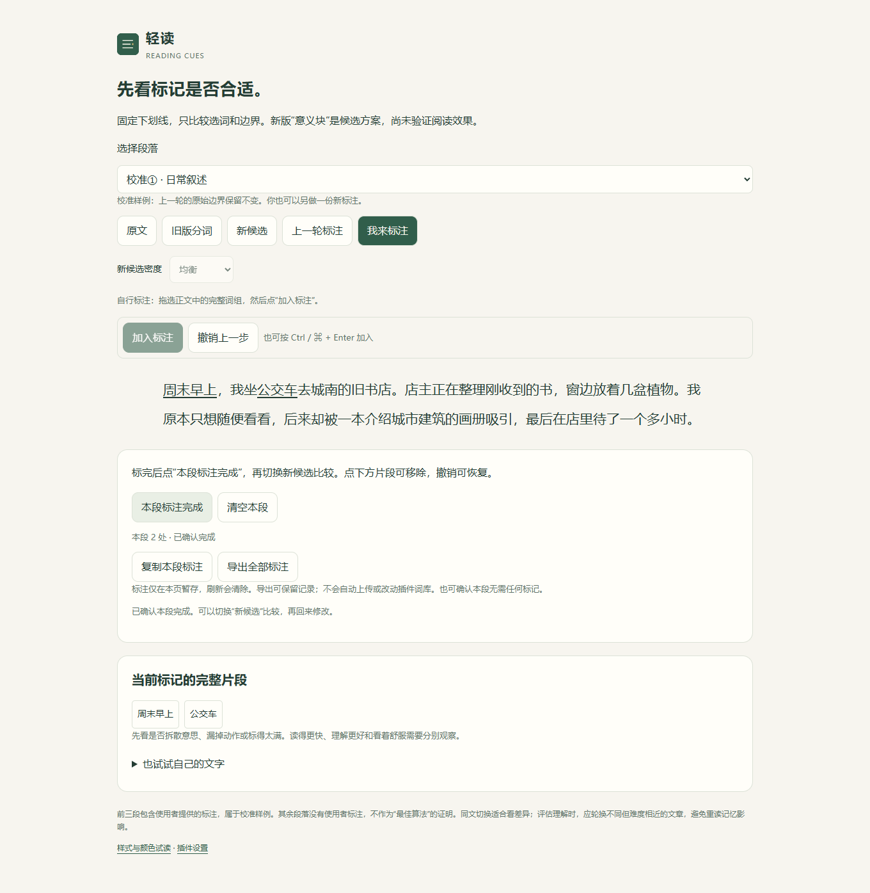

# v0.5：先修会改变意思的边界，再收集新标注

日期：2026-10-20。没有新收到的使用者标注；本轮没有提高默认密度，也没有把新增工程例句当作用户的正确答案。

## 可复现的问题与修正

| 输入 | v0.4 无密度过滤的候选中的问题 | v0.5 结构候选 |
| --- | --- | --- |
| 这个结果并不稳定 | 单独的“稳定” | “并不稳定” |
| 没有完成审核的申请不能自动通过 | “没有”与“完成审核”拆开，遗漏后一个动作 | “没有完成审核”“不能自动通过” |
| 价格降低了20元；价格降低到20元 | 两处只有“降低” | “降低了20元”“降低到20元” |
| 电量不足20%；温度不要超过37.5℃ | 只有“不足”“超过” | “不足20%”“不要超过37.5℃” |
| 时间为2026年10月20日18:30，费用12.5元 | 数字单位和日期没有完整候选 | 日期时刻、金额分别完整保留 |
| 并不意味着完全失败 | 可能停在“不意味着完全” | 有长度限制的完整否定分句 |

表格检查的是边界，不表示每个候选都应在均衡密度下显示。字符预算仍会省略一些候选；不会为了塞进预算而裁断词组。日期识别只处理常见书写形式，不验证日历、金额或设备参数。范围“10-20元”“20%-30%”作为整体，避免把范围后半当成负数。

实现仍为本地静态词性和浅层规则。否定前缀附着、有限的短分句提示不能识别所有否定作用域；长句、反问、双重否定和歧义仍需人工反馈。自动片段 18 个 UTF-16 单元的上限保持不变。

## 本轮研究复核怎样约束设计

Liu 等（2013）让中文读者自行分词，发现其划分不总遵循信息处理用的标准词界，部分功能词会与实词合并。这支持我们保留个人边界反馈，但没有测试本插件的下划线或辅助效果。[原始研究](https://journals.plos.org/plosone/article?id=10.1371/journal.pone.0055440)

He 等（2021）的两个实验提示，离线分词偏好不一定反映实时阅读中的分词过程。因此，标注与算法更一致只能说明拟合偏好，不能自动推出阅读更轻松或理解更好。[原始研究](https://pmc.ncbi.nlm.nih.gov/articles/PMC8611802/)

本项目的工程判断：先保留会改变意思的修饰和单位，同时让使用者能独立、可撤销地表达边界偏好；实际阅读理解、负担、未标信息的遗漏仍要另外比较。本轮没有据此宣称临床或普遍效果。

## 让下一轮反馈可以检查

`compare.html` 新增“我来标注”。拖选正文后加入标注，支持 Ctrl / ⌘ + Enter、移除、撤销、清空和确认完成；窄屏滚动时操作条保持可见。新候选可切换轻量 / 均衡 / 较多，样式固定为下划线。

标注按原文位置保存，重复词可以只选其中一次。相邻片段保留独立边界；重叠选择按最新边界替换。上一轮内置的 31 处参考不被覆盖。

导出格式为 `kind: reading-cues-annotations`、`schemaVersion: 1`、`offsets: UTF-16`，包含文字、片段起止位置、片段文字与 `reviewed` 状态。只有使用者点击“本段标注完成”才变为已确认；修改后回到草稿。可以确认没有任何标注，区别于未检查。草稿不当作参考答案。

只在当前页暂存，刷新后清除；复制 / 导出由使用者主动触发，不自动上传、不写入插件词库、不自动训练算法。当前没有文件导入恢复功能。每页最多 20 段、每段 8,000 个 UTF-16 单元、100 个片段，每片段 2–80 个 Unicode 字符，保留最近 20 次撤销。

## 验证与边界

核心检查覆盖否定形容词、情态动作、数字单位、金额变化与结果、日期时刻、范围、标点 / 空白阻断；标注检查覆盖重复位置、Unicode、重叠替换、撤销、确认空标注、草稿与上限。浏览器检查实际选取、原生范围、HTML 保留、导出文件、刷新清除、密度和窄屏操作条。

三段校准结果与 v0.4 相同：均衡档仍是 31 处中的 24 处严格一致。没有通过修改参考或放宽计分提高分数。新加入的三段“边界检查”文字已用于开发，不是盲测材料。
