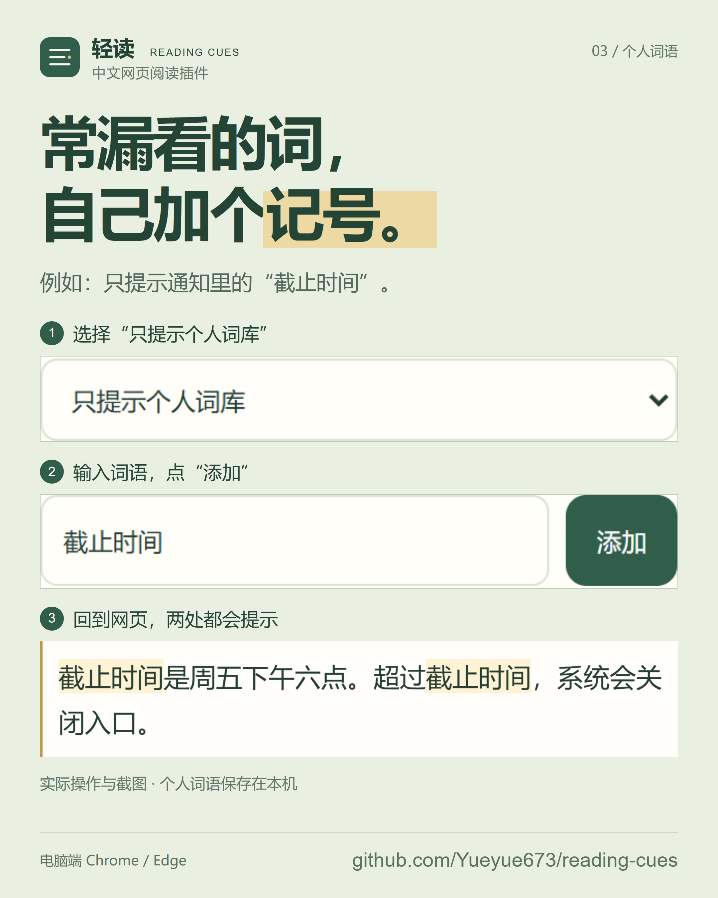

# 轻读项目海报

四张独立 PNG，尺寸均为 **2160 × 2700（4:5）**，可以单独保存、发布。面向需要中文网页阅读辅助的人，介绍当前已经可用的功能。

[打包下载四张原图](https://github.com/Yueyue673/reading-cues/releases/download/v0.6.1/reading-cues-posters-zh-CN.zip) · [安装轻读](../README.md#安装和更新)

## 01 · 这几个字，一起读

先让人知道轻读是什么。用同一段原创短句，展示默认浅色词组标记；开启前后的文字、字号和换行一致。

<a href="posters/01-phrase.png"></a>

[打开独立原图](posters/01-phrase.png)

## 02 · 读这一段，周围暗一点

呈现阅读长通知的具体场景。段落聚焦在鼠标所在段落之外绘制遮罩，不改写正文；海报同时注明它默认关闭，以及在哪里开启。

<a href="posters/02-focus.png"></a>

[打开独立原图](posters/02-focus.png)

## 03 · 常漏看的词，自己加个记号

只讲个人词语这一项功能。选模式、添加“截止时间”、回网页看两处提示，三个步骤都取自实际扩展操作。

<a href="posters/03-personal.png"></a>

[打开独立原图](posters/03-personal.png)

## 04 · 给下一篇网页，加一点颜色

说明目前需要在电脑上的 Chrome / Edge 手动安装。二维码指向 [GitHub 最新下载页](https://github.com/Yueyue673/reading-cues/releases/latest)，已从最终整张海报解码核对；电脑端也可以输入海报底部的网址。

<a href="posters/04-install.png"></a>

[打开独立原图](posters/04-install.png)

## 内容依据与使用

海报基于 v0.6.1。文案围绕“给想一起读的词，做个记号”，把实际功能、用户操作和画面放在一起。没有使用人数、效果比例或健康效果承诺。

- [README](../README.md)：当前功能、默认样式、平台范围与安装步骤。
- [隐私说明](../PRIVACY.md)：文字处理、词库和显示设置保存在本机，不上传网页正文。
- [MIT 许可](../LICENSE)：开源许可；当前版本安装包可免费下载。
- [v0.6.1 下载页](https://github.com/Yueyue673/reading-cues/releases/tag/v0.6.1)：实际可用的安装包。
- [词组、个人词语与配色代码](../src/core.js)、[实际绘制代码](../src/renderer.js)、[段落聚焦代码](../src/reading-aids.js)：截图所使用的功能实现。

海报、原创示例文字与排版源文件沿用项目 MIT 许可。可以转发，也可以按许可修改；请保留许可要求的声明。功能展示不能作为改善 ADHD、阅读障碍或专注力的证据。

## 重新制作

排版源文件在 [posters.html](posters/posters.html) 与 [posters.css](posters/posters.css)，原始截图在 [screens/](posters/screens/)。海报没有嵌入手机模型，也没有另画界面冒充截图。

需要 Node.js 22+、项目的 Playwright，以及仅用于制图的二维码工具：

```sh
npm ci
npx playwright install --with-deps chromium
npm install --prefix artifacts/poster-tools --ignore-scripts --no-package-lock qrcode@1.5.4 jsqr@1.4.0
node scripts/make-posters.mjs
```

脚本使用独立的临时浏览器和本机原创文字，实际运行扩展并检查前后正文与布局，验证两个“截止时间”范围，生成四张原图及 360 × 450 的手机尺寸检查图，再从最终海报识别二维码。检查记录保存在忽略的 `artifacts/poster-qa/`。

只调整排版时，可以使用 `node scripts/make-posters.mjs --layout-only` 复用现有截图。项目功能变化时，应重新拍摄，并更新文案、版本和入口。
